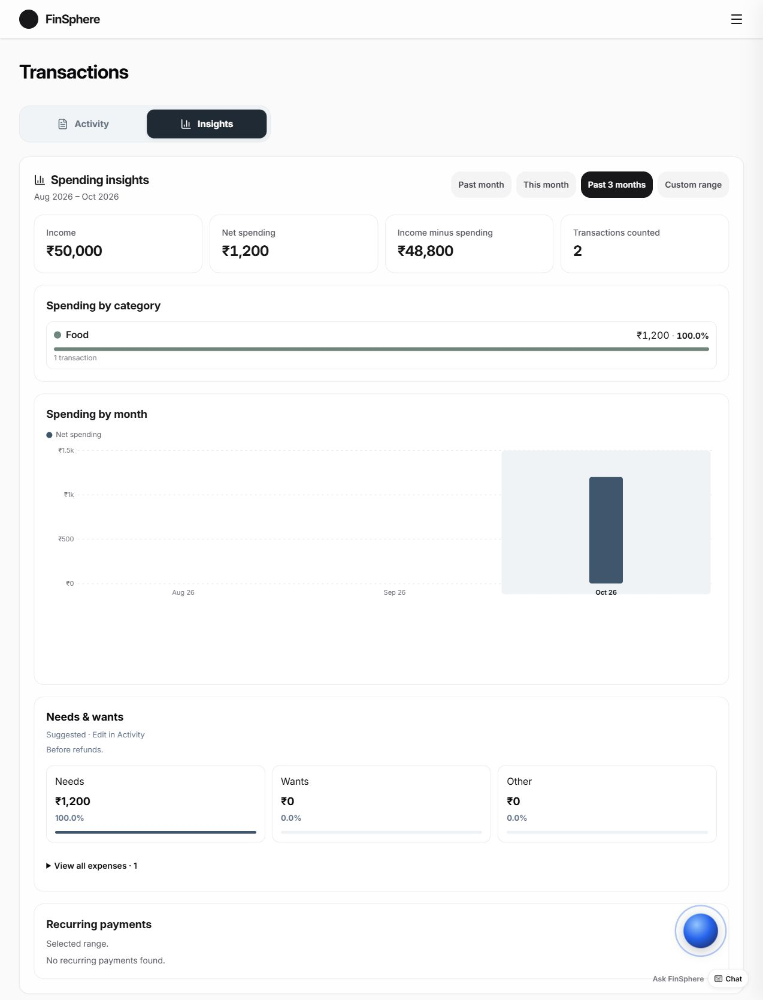
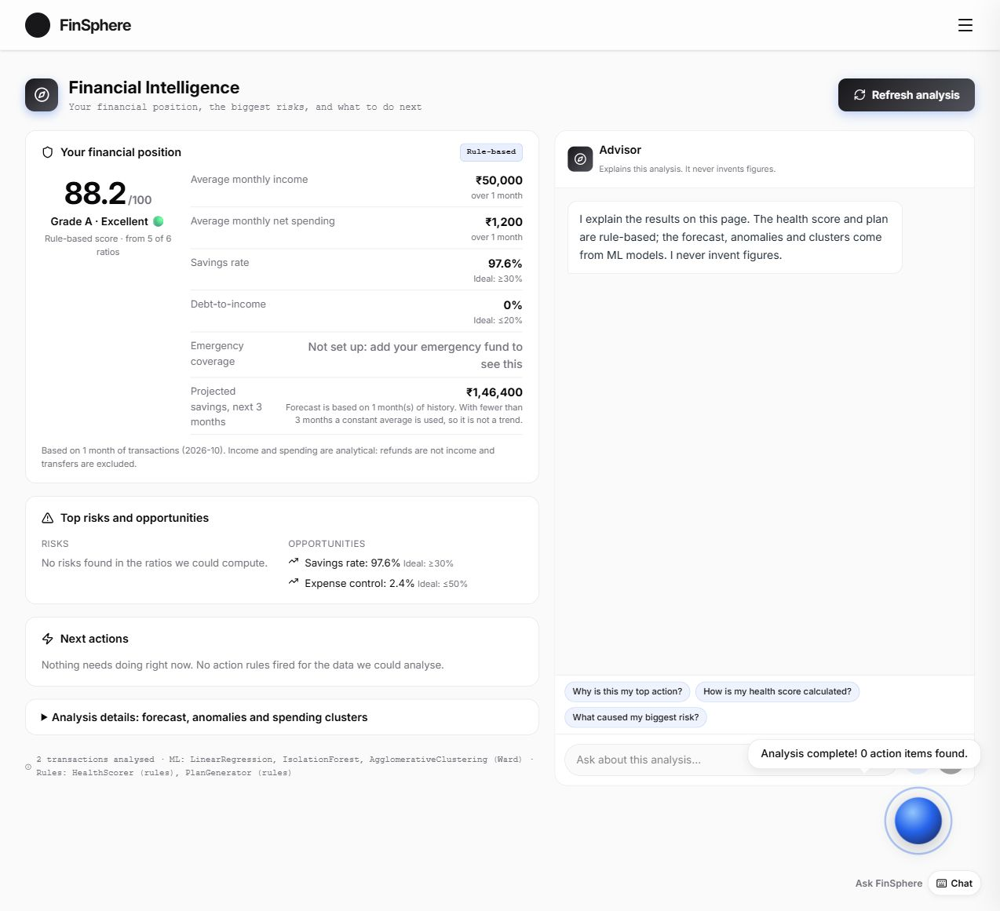

# FinSphere pre-faculty-demo finalization — October 16, 2026

Checkout: `C:\Users\udayr\OneDrive\Desktop\fin-sphere\fin-sphere`.

Presentation date: October 17, 2026 (Asia/Calcutta). Branch verified as `enhancement/profile-truthful-portfolio-20261015`, HEAD `65ff883`. Initial Git status was clean; root `AGENTS.md`, `CLAUDE.md` and `GEMINI.md` are empty. No commit, push, merge or deployment was performed.

## Outcome and boundaries

The local application passes the exercised regression and synthetic browser checks. A beginner README and minimal readiness fixes are installed. **This is not a production security clearance:** frontend development-tool and Python dependency findings remain. No faculty/report demonstration was run against the real protected databases.

- Preserved existing source except one proven disconnected stylesheet, obsolete template prose and two obsolete comment/suppression lines.
- Preserved all credentials, `.env` files, financial JSON, uploads and existing evaluation/reference artifacts.
- Neither `finsphere_faculty_demo_20261015` nor `finsphere_report_kit_20261016` was connected to by this work's API/test processes or changed. Connection credentials were loaded privately only to derive maintenance/test database connections; no secret values were printed.
- Tests used reviewed PID-named disposable databases; legacy imports were explicitly disabled. The synthetic smoke used `finsphere_final_smoke_31872` with ports 5299/5199/8199. Its services were stopped and its database removed after verification.
- No layout changes to Transactions/Insights, broad restructuring, mass deletion or database reset.

## Functional readiness fixes

1. `server/runtimeConfig.js` validates proxy settings and legacy migration policy. Production legacy JSON import defaults off; `IMPORT_LEGACY_JSON=true` is explicit opt-in. `false` disables imports everywhere, including development/test/demo. Existing development default is retained when unset for compatibility.
2. `server/db/index.js` enforces that policy at the actual import boundary for users, transactions, goals and liabilities. A dedicated test proves malformed legacy JSON is ignored by default in production and actually attempted with opt-in. Schema startup remains unchanged and still requires a backup/review for valuable databases.
3. `TRUST_PROXY=false` now works as a boolean false. Nonnegative safe hop counts, known aliases and valid IP/subnet lists are accepted; bare true, invalid strings, negative/fractional/unsafe counts fail startup. Host proxy topology still requires verification.
4. `GET /api/health` returns only `{status: 'ok'}` after `SELECT 1`, or 503/unavailable. It probes PostgreSQL, not Python/Groq/email. API responses, including body-parser failures, receive `Cache-Control: no-store`; profile image responses already had private/no-store.
5. HTTP shutdown stops accepting requests and drains active requests before closing the database pool; a 10-second deadline prevents indefinite shutdown. Windows forced process termination may bypass signal handlers; host graceful-drain behavior remains unverified.
6. Deprecated Multer 1.4.5-lts.2 replaced by exact 2.4.0. Lockfile and installation lost 13 unused transitive packages. OCR, upload limits, image handling, duplicate import and security regressions pass. Version selection checked against the [maintainer releases](https://github.com/expressjs/multer/releases); the [maintainer advisories](https://github.com/expressjs/multer/security/advisories) document the affected older series.
7. Security test configuration now explicitly clears optional password mail settings so a developer's local-mail mode cannot invalidate its production-mode scenario. No real email was sent.

## Comments and contracts

Added concise explanations for auth/session ownership, provider parsing as untrusted data, server-to-Python data ownership, OCR abort/queue contracts, duplicate-preview HMAC integrity versus authorization, manual portfolio paise/zero handling, voice confirmation boundaries, cross-language money semantics and forecasting R-squared/fallback limits. Existing detailed SQL locking, duplicate multiset matching and account-switch comments were retained. Corrected a misleading claim that JavaScript floating-point amounts are exact; SQL totals remain exact numeric arithmetic.

## README contents

The root README now covers system overview, ASCII architecture, verified installed versions, folder map, Windows prerequisites, PostgreSQL service/tools, safe environment templates, first-time setup, three-terminal startup, protected dev/demo/report/production DB separation, page behavior, synthetic workflows, import/OCR/duplicate review, portfolio and assistant confirmations, tests/build/audit commands, screenshots, security limits, backup/restore precautions and rollback.

Its prominent troubleshooting table covers blank Insights, API failure, CORS/cookie/session issues, account-changed 409, PostgreSQL/schema, Python ports, Groq fallback, microphone permissions, OCR worker/5MB/dimensions/queue, duplicate-review 409 versus actual errors, password reset email, build-time VITE_API_URL, TRUST_PROXY, port conflicts, dependencies/builds, stale caches and wrong demo account/port. A safe diagnostic sequence warns against exposing secrets or running destructive SQL. A timed 10-minute faculty-demo startup and offline/service-failure contingencies are included.

## Validation summary

| Check | Actual result |
|---|---|
| Complete frontend file set | 25/25 files passed; aggregate runner time 207.63 s |
| Complete server runner | 24/24 files passed; aggregate runner time 90.20 s |
| Separate reset DB test | 1/1 passed in a newly provisioned `finsphere_reset_test_<pid>` database; then dropped |
| Python unit tests | 40/40 passed |
| Synthetic Python evaluation | 416 records generated; health scorer 46/46; plan generator 36/36 |
| Frontend build | Passed; final measured Vite build 16.05 s; large-chunk warning remains |
| ESLint | Passed, zero errors/warnings after removing obsolete suppression; rerun after new DB test also passed |
| Git whitespace check | Passed; only normal Windows LF/CRLF conversion notices |
| Full API npm audit | Zero known vulnerabilities reported |
| Root production-only npm audit | Zero known vulnerabilities reported |
| Full root npm audit | Failed with 2 findings: high Vite, moderate esbuild; development toolchain |
| Installed Python dependency audit | 16 advisory entries across 4 packages, 9 unique IDs; unresolved |
| Real-browser focused smoke | Passed within the limited synthetic scenarios below |

The checks are functional regressions, not proof of all production threat models. Times were measured amid concurrent checks and are not controlled performance benchmarks. Main frontend JS remains about 771.18 kB minified / 237.77 kB gzip; splitting was deferred to avoid presentation risk.

### Frontend suites

| Test file | Result | Seconds |
|---|---|---:|
| `accountGuardAvatarUi.test.mjs` | PASS | 3.41 |
| `accountGuardPagesUi.test.mjs` | PASS | 4.03 |
| `accountGuardUi.test.mjs` | PASS | 2.62 |
| `actionConfirmation.test.mjs` | PASS | 0.17 |
| `assistantIntent.test.mjs` | PASS | 0.17 |
| `assistantReplyUi.test.mjs` | PASS | 3.31 |
| `categoryPickerUi.test.mjs` | PASS | 6.3 |
| `companionState.test.mjs` | PASS | 0.22 |
| `duplicateReviewUi.test.mjs` | PASS | 12.59 |
| `financialCopilot.test.mjs` | PASS | 118.33 |
| `forecastChartUi.test.mjs` | PASS | 2.77 |
| `imageStatementUi.test.mjs` | PASS | 9.2 |
| `monthRange.test.mjs` | PASS | 0.22 |
| `onboardingUi.test.mjs` | PASS | 3.44 |
| `passwordRecoveryUi.test.mjs` | PASS | 3.94 |
| `plansIntelligence.test.mjs` | PASS | 5.67 |
| `profilePortfolioUi.test.mjs` | PASS | 3.64 |
| `sessionIsolationUi.test.mjs` | PASS | 3.7 |
| `settingsProfileUi.test.mjs` | PASS | 6.67 |
| `speechText.test.mjs` | PASS | 0.25 |
| `spendingAnalytics.test.mjs` | PASS | 0.69 |
| `spendingAnalyticsUi.test.mjs` | PASS | 4.53 |
| `spendingPriorities.test.mjs` | PASS | 0.23 |
| `statementImportA11y.test.mjs` | PASS | 8.31 |
| `transactionEditorUi.test.mjs` | PASS | 3.22 |

The first copilot attempt was killed at a 50-second diagnostic limit. An instrumented bounded rerun passed, then the unchanged original test passed **173 checks in 118.33 seconds** with a 180-second limit. It contains many deliberate timer waits. No functional assistant stall was established. UI fixtures print some expected simulated-error/React-act/build-cancellation warnings; final assertions and exits passed.

### Server suites

| Test file | Result | Seconds |
|---|---|---:|
| `accountGuard.test.mjs` | PASS | 4.09 |
| `actionExtract.test.mjs` | PASS | 0.41 |
| `actions.test.mjs` | PASS | 10.8 |
| `chat.test.mjs` | PASS | 6.2 |
| `groq.test.mjs` | PASS | 7.22 |
| `holdingsServer.test.mjs` | PASS | 3.58 |
| `imageOcr.test.mjs` | PASS | 3.62 |
| `imageOcrServer.test.mjs` | PASS | 4.99 |
| `importDuplicates.test.mjs` | PASS | 0.2 |
| `importDuplicatesServer.test.mjs` | PASS | 16.78 |
| `liabilityActions.test.mjs` | PASS | 0.28 |
| `naturalActions.test.mjs` | PASS | 0.34 |
| `onboardingServer.test.mjs` | PASS | 4.58 |
| `passwordReset.test.mjs` | PASS | 0.19 |
| `passwordResetLocal.test.mjs` | PASS | 6.66 |
| `plans.test.mjs` | PASS | 2.69 |
| `profileImage.test.mjs` | PASS | 0.17 |
| `profileServer.test.mjs` | PASS | 4.41 |
| `runtimeConfig.test.mjs` | PASS | 0.17 |
| `runtimeConfigDb.test.mjs` | PASS | 1.01 |
| `security.test.mjs` | PASS | 6.08 |
| `transactionCategory.test.mjs` | PASS | 2.66 |
| `transactionEdit.test.mjs` | PASS | 2.88 |
| `transactionEditContract.test.mjs` | PASS | 0.19 |

`passwordResetDb.test.mjs` ran separately because it demands its own explicitly named, pre-provisioned disposable database. Notable final counts: security 71 checks; assistant actions 251 checks; real-server duplicate imports 131 checks; OCR unit suite 23 tests including real offline recognition and worker timeout termination. The new configuration unit tests first failed for the missing helper, then passed after implementation.

The first security run failed because dotenv loaded an existing `PASSWORD_RESET_DELIVERY=local` setting while that test requested production. Its environment is now explicitly isolated; both focused and complete reruns pass. This was not fixed by weakening the production restriction.

### Python audit details

The scanner ran in a separate temporary environment; application packages were not upgraded. It audited 24 installed packages in the resolved application dependency closure using exact installed versions and no dependency re-resolution. Results are not a scan of every unrelated global Python package or a freshly resolved install. Missing optional Uvicorn standard extras in the inspected global environment: websockets, watchfiles, PyYAML, httptools. The actual service and tests worked using its installed HTTP stack; a clean environment still needs separate validation.

| Package | Installed | Advisory entries / unique IDs | Reported fix versions |
|---|---|---|---|
| anyio | 4.12.1 | 2 / 2 | 4.14.2 |
| idna | 3.11 | 2 / 1 | 3.15 |
| python-dotenv | 1.2.1 | 2 / 1 | 1.2.2 |
| starlette | 0.52.1 | 10 / 5 | 1.0.1, 1.1.0, 1.3.0, 1.3.1 |

Some advisory records repeat IDs; 16 is the scanner's entry count and 9 is the unique-ID count. Starlette fixes span major versions and require a coordinated FastAPI compatibility review; no global upgrades were attempted before the demo. Keep Python private and do not publicly deploy this audited environment until remediated and retested. Example primary advisories include [AnyIO process-worker deadlock](https://github.com/advisories/GHSA-5p39-cfhj-2xmp), [idna resource exhaustion](https://github.com/advisories/GHSA-65pc-fj4g-8rjx), and [Starlette Windows StaticFiles issue](https://github.com/advisories/GHSA-wqp7-x3pw-xc5r). Applicability depends on used features; private binding is a mitigation, not a vulnerability fix.

### Browser smoke and intermittent Insights

Used the built-in browser against the isolated synthetic API/database; no real account credentials or bank files were used.

- Signed in and dismissed first-time onboarding.
- Dashboard displayed salary 50,000, groceries 1,200 and balance 48,800.
- Transactions Activity showed exactly those two rows.
- Insights displayed income 50,000, spending 1,200, net cash flow 48,800, two counted records; category drilldown showed the grocery row.
- Past month (September) showed the explicit empty-period message; no blank panel reproduced.
- Revisited Transactions/Insights after source hot reload; it rendered again.
- Financial Intelligence called the actual private Python service: health 88.2, savings rate 97.6%, no invented emergency fund, and an explicit one-month/constant forecast caveat.
- With Groq disabled, the assistant answered spending 1,200 and showed matching financial cards.
- A lunch request showed an explicit 450-rupee confirmation card; Cancel returned “Nothing was saved”. No transaction execution was requested in this browser workflow.

The blank Insights report remains intermittent and unconfirmed. No CSS/layout rewrite was made. Future reproduction should record account, origin/port, date range, Network status and redacted Console stack. Source hot reload resets navigation during development and was observed; it is not evidence of a released-build Insights defect.

Manual/browser limits: live microphone recognition, real bank OCR images, live Groq and actual email delivery were not exercised; their mocked/API regressions do not establish provider availability. No production host or protected faculty account was smoke-tested.

## Cleanup and retained material

See [CLEANUP_INVENTORY.md](CLEANUP_INVENTORY.md) for the exact removed transitive lock entries and rollback guidance. Only `src/components/Sidebar.css` was deleted as a source file: no reference/import was found and the app build and tests pass without it. Its original remains in Git and an exact safety copy was kept outside the checkout. Empty docs/guidance and legacy data were deliberately retained.

Two synthetic PNGs under `docs/screenshots/` are intentional documentation assets. No database dump, credentials, real statement, test log, temporary test harness, generated evaluation output, virtual environment or compiled `dist` content was added to version control. Those runtime artifacts remain ignored or in the separate chat workspace.

## Remaining issues and deployment-owner work

1. Resolve audited Python dependency findings in an isolated pinned environment, then repeat tests/evaluation/browser smoke. Do not expose the private Python API.
2. Upgrade the frontend Vite/plugin toolchain in a separate reviewed change to clear Vite/esbuild audit findings. No `audit fix --force` was run.
3. Confirm host HTTPS, SPA routing/static hosting, final build-time API URL, same-site cookies, exact CORS, trusted proxy topology, verified DB TLS, secret provisioning and private service networking.
4. Establish and restore-test backups, versioned migrations/rollbacks, least-privilege roles, monitoring and rate-limit storage for multiple instances.
5. Review spreadsheet parser isolation/expanded-archive limits and the explicit legacy duplicate-bypass route. Current authenticated/rate/upload limits are not a sandbox.
6. SIPs & Subs is a hardcoded example page. Portfolio uses manual dated valuations, not live prices. Forecast missing calendar months and synthetic-only evaluation limitations remain documented; R-squared is in-sample.
7. Test real email sender and live provider models, microphones and target browsers independently. Windows hard termination and deployment host graceful shutdown remain unverified.

## Run the prepared local app

The following assumes dependencies are installed and private `server/.env` points at the deliberately selected, already prepared environment. **Starting the API applies schema statements; do not start it against a protected database as an ad-hoc test.** Read the README's database separation and startup checklist first.

From the checkout root in three terminals:

```powershell
# Python terminal (use the verified global Python or your validated venv interpreter)
Set-Location ml_service
python main.py
```

```powershell
# API terminal
$env:IMPORT_LEGACY_JSON='false'
npm.cmd --prefix server start
```

```powershell
# Frontend terminal
npm.cmd run dev -- --host localhost --port 5173 --strictPort
```

Verify `http://localhost:5000/api/health` and `http://127.0.0.1:8000/health`, then open `http://localhost:5173`. If using different ports, align VITE_API_URL, CORS_ORIGINS, ML_SERVICE_URL and ML_SERVICE_PORT. Do not copy the temporary smoke account into the real demo environment; its disposable database was removed.

## Exact changed files and Git handoff

```text
 M README.md
 M docs/SECURITY_DEPLOYMENT.md
 M ml_service/models/forecaster.py
 M server/.env.example
 M server/db/index.js
 M server/holdings.js
 M server/imageOcr.js
 M server/importDuplicates.js
 M server/package-lock.json
 M server/package.json
 M server/server.js
 M server/tests/security.test.mjs
 D src/components/Sidebar.css
 M src/context/FinanceContext.jsx
 M src/hooks/useVoiceSession.js
 M src/pages/Portfolio.jsx
 M src/utils/actionConfirmation.js
 M src/utils/finance.js
 M vite.config.js
?? docs/CLEANUP_INVENTORY.md
?? docs/FINALIZATION_REPORT.md
?? docs/screenshots/finsphere-insights-synthetic.png
?? docs/screenshots/finsphere-intelligence-synthetic.png
?? server/runtimeConfig.js
?? server/tests/runtimeConfig.test.mjs
?? server/tests/runtimeConfigDb.test.mjs
```

Final read-only verification: PostgreSQL server 18.6; owned smoke DB absent in the maintenance catalog; no listeners remained on test ports 5199/5299/8199.

Git status is intentionally dirty with reviewable, uncommitted changes. HEAD remains `65ff883`. No files are staged.

The screenshots below contain only synthetic data.




